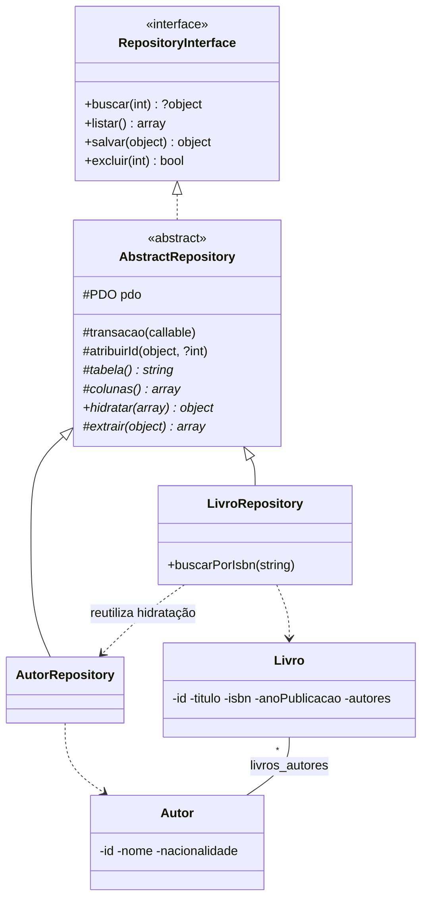

# BibliotecaORM

Mini-ORM em **PHP puro + PDO** (sem ORM de terceiros) para a biblioteca da universidade.
Mapeia `Livro` e `Autor` para MySQL mantendo o **domínio separado da infraestrutura**.
Projeto avaliativo de Programação II.
Aluna: Kauanny Ribeirop da Silva

## Requisitos

- PHP 8.1+ com extensões `pdo_mysql` e `mbstring`
- MySQL 8.0+ (ou MariaDB 10.4+)
- Nenhuma dependência de Composer (autoloader próprio em `src/autoload.php`)

## Como executar

```bash
# 1) Criar banco, tabelas, PKs e FKs
mysql -u root -p < sql/schema.sql

# 2) (opcional) dados de exemplo
mysql -u root -p < sql/seed.sql

# 3) Usuário dedicado (troque a senha)
mysql -u root -p -e "CREATE USER 'biblioteca_app'@'localhost' IDENTIFIED BY 'TROQUE_ESTA_SENHA';
                     GRANT ALL ON biblioteca_orm.* TO 'biblioteca_app'@'localhost';"

# 4) Configuração local (o .env está no .gitignore)
cp .env.example .env      # edite DB_USER / DB_PASS

# 5) Demonstração das 7 evidências
php demo/demo.php
php demo/demo.php | tee docs/evidencias.txt   # para anexar ao relatório

# 6) Testes (domínio + integração; integração é pulada se não houver banco)
php tests/run_tests.php
```

As variáveis de ambiente (`DB_HOST`, `DB_PORT`, `DB_NAME`, `DB_USER`, `DB_PASS`) têm precedência sobre o `.env`.

## Arquitetura

```
src/
├── Contract/RepositoryInterface.php         # contrato: buscar, listar, salvar, excluir
├── Domain/                                  # domínio puro (sem PDO/SQL)
│   ├── Identificavel.php
│   ├── Autor.php
│   └── Livro.php
└── Infrastructure/                          # persistência
    ├── Config.php / Connection.php          # .env/variáveis -> PDO seguro
    └── Repository/
        ├── AbstractRepository.php           # ORM genérico (Template Method)
        ├── AutorRepository.php
        └── LivroRepository.php              # + N:N via livros_autores
demo/demo.php        # as 7 evidências
tests/run_tests.php  # testes reproduzíveis
sql/schema.sql, sql/seed.sql
```



## Mapa requisito → código

| Req. | Onde |
|------|------|
| R1 modelo relacional | `sql/schema.sql` (PKs, FKs, UNIQUE em `isbn`, PK composta no vínculo) |
| R2 entidades | `Domain/Livro.php`, `Domain/Autor.php`: propriedades privadas, validação, **sem `setId()`**; o id é gravado só pela infraestrutura |
| R3 contrato | `Contract/RepositoryInterface.php` |
| R4 herança/abstração | `AbstractRepository` (buscar, listar, salvar, excluir, transacao, atribuirId…) + 2 repositórios que só especializam `tabela/colunas/hidratar/extrair` |
| R5 polimorfismo | `demonstrarContrato(RepositoryInterface $repo, object $e)` em `demo/demo.php` (sem `if`/`instanceof`) |
| R6 CRUD | Livro: todos; Autor: INSERT, SELECT (e também listar/excluir, pelo contrato) |
| R7 hidratação | `hidratar()` com *casts* explícitos (`int`, `string`, `null`) |
| R8 N:N | `LivroRepository::persistirRelacionamentos / hidratarLote` — mapa de identidade: mesmo autor = mesma instância no carregamento |
| R9 segurança/transações | prepared statements reais (`EMULATE_PREPARES=false`); `ident()` só aceita `[A-Za-z_][A-Za-z0-9_]*`; `ORDER BY` por lista branca; `salvar()`/`excluir()` transacionais com rollback |
| R10 organização | camadas separadas, README, SQL, demo e testes; `.env` ignorado pelo Git |

## Chaves estrangeiras (evidência 7)

`livros_autores` referencia `livros` e `autores` com `ON DELETE RESTRICT`:

- **Excluir um autor vinculado a livros é bloqueado** pelo MySQL (erro 1451, SQLSTATE 23000), preservando a integridade.
- **Excluir um livro** é feito por `LivroRepository::excluir()`, que remove os vínculos e depois o livro **na mesma transação**: ou tudo acontece, ou nada.
- Inserir vínculo para autor/livro inexistente viola a FK (erro 1452) — é o erro usado para demonstrar o *rollback*.

## Limitações conhecidas

- ISBN validado por formato (10/13 dígitos), sem cálculo do dígito verificador.
- Sem *lazy loading*, *unit of work* nem controle de concorrência otimista.
- O mapa de identidade vale por carregamento (`buscar`/`listar`), não é cache global.
- Hidratação reexecuta as validações do domínio: dado inválido inserido "por fora" do ORM lança exceção ao ler.
- Tabela `exemplares` apenas esboçada (comentada) no schema.

## Relatório técnico

`python3 docs/gerar_relatorio.py` gera `docs/relatorio_tecnico.pdf` (requer `reportlab`). Se `docs/evidencias.txt` existir, a saída real do demo é incorporada ao PDF.
